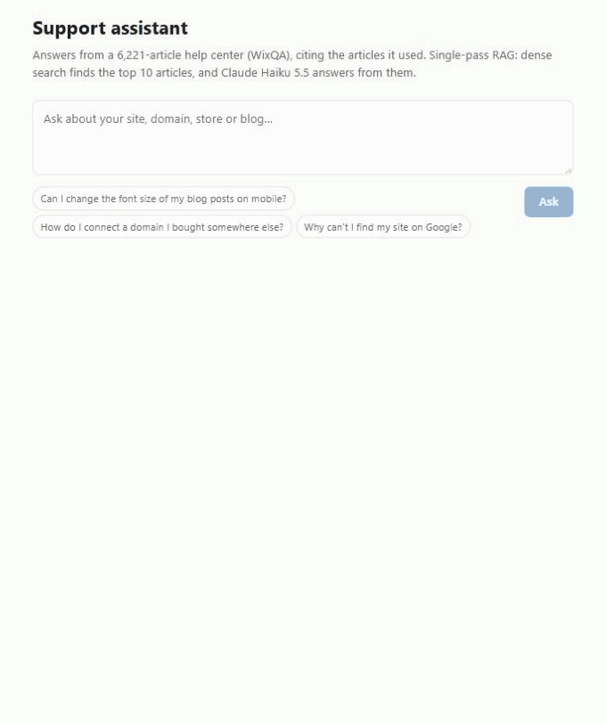
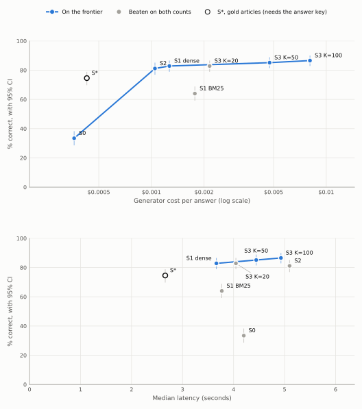
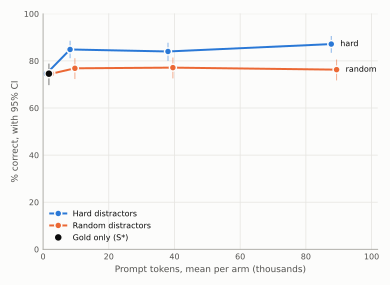

# Enterprise support RAG

[](https://github.com/Xiaohui-Lu/enterprise-support-rag/actions/workflows/ci.yml)

A support assistant for a 6,221-article help center, built to answer one question with data: **when do retrieval, agentic search and long context each pay off?** Closed-book answering, single-pass RAG, agentic search and long-context prompting run on the [WixQA](https://huggingface.co/datasets/Wix/WixQA) benchmark with the model held constant, and are compared on correctness, cost and latency.



*A real answer from the Docker Compose stack, at about real speed: the articles it read appear first, then the answer streams in, with each citation linked to its article. First words at 0.6 s, done at 1.3 s, for $0.0006.*

**[Read the write-up](docs/writeup.md)**: what was found, and why, in a few minutes.

> The project is complete: Steps 0 to 10 and milestones M1 to M3 are done. One planned check was left undone, a hand audit of the judge's panel labels (see [Caveats](#caveats)). See the [roadmap](docs/experiment-design.md#12-roadmap).

## Results (M2)

Each of the 350 real questions in the held-out test set was answered once by Claude Haiku 5.5 with every strategy, and graded by Claude Sonnet 5.5 against WixQA's expert-written reference answer.

| Strategy | What the model sees | % correct [95% CI] | Cost per answer | Latency p50 | Input tokens |
|---|---|---:|---:|---:|---:|
| S0, closed book | The question only | 33.4% [28.6, 38.3] | $0.00036 | 4.2 s | 138 |
| S1, single-pass RAG on BM25 | BM25's top 10 articles | 64.0% [59.1, 68.9] | $0.00177 | 3.8 s | 14,201 |
| **S1, single-pass RAG on dense search** | **Dense search's top 10 articles** | **82.9% [78.9, 86.6]** | **$0.00127** | **3.7 s** | **9,076** |
| S2, agentic search | What it chooses to search for and read | 81.1% [76.9, 85.1] | $0.00105 | 5.1 s | 9,711 |
| S3, long context, K=20 | Dense search's top 20 articles | 82.9% [78.9, 86.6] | $0.00215 | 4.0 s | 17,694 |
| S3, long context, K=50 | Dense search's top 50 articles | 85.1% [81.4, 88.9] | $0.00474 | 4.4 s | 43,363 |
| S3, long context, K=100 | Up to 100, capped below 90K tokens | 86.6% [82.9, 90.0] | $0.00807 | 4.9 s | 76,565 |
| S\*, oracle context | Exactly the gold articles | 74.6% [69.7, 78.9] | $0.00043 | 2.7 s | 1,785 |

Bold is the default. S0, S1 on BM25 and S\* are M1's runs, reused.



What this shows:

- **Nothing beat single-pass RAG on dense search.** Five strategies were each compared with it on the same questions. To replace it, a strategy needed a paired 95% interval above zero and a Holm-adjusted p below 0.05 over the five, a rule written down before the run (D-046).
  - S3 at K=100 came closest: +3.7 points [+0.6, +7.1], but McNemar's p is 0.047, and 0.19 after Holm. One comparison out of five scraping past 0.05 is what the bar was written for.
  - If the gain is real, it costs about $0.18 per extra correct answer. That's cheap next to a ticket a person handles, so it's worth a confirmatory test on fresh questions, not a switch on this one.
- **The cost frontier is S0 → S2 → S1 dense → S3 K=50 → S3 K=100.** These are the strategies that nothing else beats on both cost and accuracy.
  - Only the first step is shown to add correct answers: 47.7 points [+41.4, +53.7], at $0.0014 per extra correct answer.
  - Each later step adds 1.4 to 2.3 points, with an interval that includes zero.
- **Agentic search didn't earn its loop.** S2 is on the frontier only because prompt caching makes it 17% cheaper than S1. It's 1.4 s slower at the median and 1.7 points less accurate [−5.7, +2.0]. It searched 2.1 times and read 2.0 articles per question, and no limit ever fired.
- **Better retrieval was the biggest lever.** Dense search beat BM25 by 18.9 points [+14.0, +23.7], and cost less, because its top 10 articles are shorter. Retrieval now adds 49.4 points over closed book, against 30.6 with BM25.
- **The gold articles aren't a ceiling.** Dense S1 beat S\* by 8.3 points [+3.7, +12.9]. Ten related articles answer more completely than the gold ones alone: WixQA's gold articles aren't the only place an answer lives.
- **By question type,** directionally (the groups are small): on the 70 multi-article questions, S3 at K=20 scored 87.1% against S1's 78.6%. S2 is ahead of S1 on no type by more than 1.1 points. These are the leads for Step 7's router.

Full tables, including each type and the latency frontier: [reports/answers_comparison_test.md](reports/answers_comparison_test.md).

### Does a long prompt rot?

Context rot is accuracy falling as the prompt grows, even though the answer is in it. Each question's gold articles were buried among distractors up to an estimated 10K, 40K or 90K tokens, each gold article at one random depth that stays the same in every arm. Hard distractors are the non-gold articles dense search ranks highest; random ones are drawn from the rest (D-045).



| Distractors | Gold only | 10K | 40K | 90K |
|---|---:|---:|---:|---:|
| Hard (look-alike articles) | 74.6% | 84.9% | 84.0% | 87.1% |
| Random | 74.6% | 76.9% | 77.1% | 76.3% |

- **No rot up to 90,000 tokens.** From 10K to 90K, hard moved +2.3 points [−0.9, +5.7] and random −0.6 [−4.0, +2.6].
- **Look-alike distractors helped rather than hurt.** Hard beat random at every size, by 6.9 to 10.9 points (Holm's p at most 0.003), and 73% to 78% of hard answers cited a look-alike. Neighbouring help-center articles often carry part of the answer.
- **That differs from [Chroma's 2025 context-rot study](https://research.trychroma.com/context-rot),** where similar distractors hurt more. Theirs were built to mislead; these are real articles from the same help center. The result holds for Claude Haiku 5.5, this corpus and these sizes.
- **No "lost in the middle".** At hard 90K, single-article questions did best with the gold article in the middle third of the context: 91.5%, against 80.2% in the first third and 84.0% in the last (directional).

Full tables: [reports/context_rot_test.md](reports/context_rot_test.md).

### Does a router pay?

The router, R2, answers with S1 by default. It sends a question to S3 at K=100 instead when dense search's best match is weak, or when S1 declines.
- Only one dev question could be fixed by routing, so the threshold wasn't tuned. It was set by a 20% escalation budget on dev (D-047, D-048).
- It ran once on test. Every call came from the call cache, so the run cost nothing.

| 350 test questions | % correct [95% CI] | Cost per answer |
|---|---:|---:|
| S1, dense search | 82.9% [78.9, 86.6] | $0.00127 |
| R2, router | 84.9% [81.1, 88.6] | $0.00351 |
| Random escalation at R2's rate | 84.1% (expected) | $0.00356 |
| S3, K=100 | 86.6% [82.9, 90.0] | $0.00807 |
| Hindsight oracle over S1 and S3 | 90.0% | $0.00176 |

- **R2 keeps about half of long context's gain, at 44% of its cost, but that gain isn't shown to be real.** Against S1, R2 is +2.0 points [+0.0, +4.3], and its Holm-adjusted p is 0.24.
- **Its signal barely beats chance.**
  - Sending a random 34% of questions to S3 would score 84.1%. R2 is only +0.7 points [−0.9, +2.5] above that.
  - The weak-score rule alone adds +0.2. S1's decline carries real information, but it fires on only 3% of questions.
- **The room exists, but cheap signals don't find it.** Choosing between S1 and S3 per question with hindsight would score 90.0% at $0.00176 per answer.
- **The dev budget didn't carry over.** Test questions score lower on dense search than dev's. So 34% were escalated instead of 20%, and the cost rose with them. A deployed router would need its escalation rate monitored.

Full tables: [reports/router_test.md](reports/router_test.md).

### Earlier: M1

M1 ran S0, S1 on BM25 and S\* (commit `eadbd6a`). Retrieval added 30.6 points over closed book [+23.7, +37.1], and perfect retrieval would have added another 10.6 [+4.9, +16.3]: a gold article was in BM25's top 10 for only 57% of test questions. That gap set Step 4's target, and dense search more than closed it. The 50 dev questions couldn't see the gap (+2 [−14, +18]); the test set is 7 times larger, so its intervals are about 2.6 times narrower. See [reports/answers_test.md](reports/answers_test.md).

### How it was measured

- **One generator for every strategy:** Claude Haiku 5.5 at medium effort, with the same prompt and answer format: numbered articles, inline citations, and an exact decline when the answer isn't there (D-023).
- **The strategies:**
  - Dense search embeds articles with voyage-4-nano and searches them exactly in Postgres with pgvector (D-035, D-041). Hybrid fusion, two rerankers and searching by section were tried on dev and didn't beat it (D-037 to D-039).
  - S2 is a hand-written tool loop with two tools, `search` (numbered snippets) and `read` (a full article), at most 6 steps and 30,000 prompt tokens, with prompt caching (D-043).
  - S3 sends dense search's top K articles, best first, and stops before an estimated 90,000-token prompt, 10% under the 100,000-token line where the price per token rises (D-044). No prompt crossed that line.
- **Grading:** Claude Sonnet 5.5 at high effort compares each answer with the reference and grades it correct, partial or incorrect. Only correct counts, and a decline counts as incorrect (D-025).
- **The judge was validated before use** against 80 labels on dev answers: Cohen's kappa 0.82 on the three grades and 0.92 on correct vs not (D-031). 65 labels are the unanimous votes of a panel of four Claude configurations; a person labeled the 15 items the panel split on (D-028). See [reports/judge_validation.md](reports/judge_validation.md).
- **Statistics:** 95% intervals come from a bootstrap over questions. Comparisons use a paired bootstrap and McNemar's exact test, with Holm's adjustment over each table of comparisons (D-032). M2's verdict rule, the frontier and the context-rot measure were all written down before any M2 run (D-045, D-046).
- **Tuning happened on dev only.** Every setting was chosen on 50 dev questions (D-033, D-036, D-042). The test set runs only at a named milestone and from a clean commit, enforced in code. M1 ran from commit `eadbd6a`, M2 from `9d1b5fa` and the router from `d544f94` (tagged M3), each once, and nothing was changed after seeing the results (D-034).
- **Cost:** M1 cost about $4.60 and M2 $29.35: about $15 for the five new strategies and $14.35 for context rot. The strategies' answers ran in real time, so their latency is real. Context-rot answers and all grading went through the batch API.

### Caveats

- The 65 panel labels weren't audited by hand. They come from Claude models, which can share the judge's blind spots, and a planned random audit of about 12 was left undone when the project closed (D-028). The judge's agreement is reported separately on them and on the 15 hand labels.
- The judge is weakest where people disagree too. On the 15 borderline items, it matched the human label on only 8 (kappa 0.33 on correct vs not).
- The judge also leans lenient. On the 80 labels, it graded 3 not-correct answers correct and never the reverse (55% correct against the labels' 51%). Absolute rates may run a few points high; differences between strategies are affected less.
- Each strategy was run once, and the generator isn't deterministic. The intervals cover which questions were drawn, not which answers the model happened to write.
- Dev runs high. Settings were picked on dev, which flatters it: dense S1 scored 90% on dev and 82.9% on test, as BM25 went from 76% to 64% at M1.
- Latency comes from one machine at one time. The first real-time answer of each run also counted a cold import of the Anthropic SDK, up to about 23 s. That was found and fixed in Step 8 (D-050). Every other M2 answer took under 18 s.
- "Correct" means "agrees with WixQA's reference answer", and a reference can itself be incomplete.

## How it's built

How a question is answered (D-050):


Where it runs, and how a change is checked (D-052, D-053):

![A system diagram. On your machine, Docker Compose runs the app container (FastAPI service and built page, with the articles and voyage-4-nano baked in), the db container (Postgres with pgvector) and a volume for the service's own call cache. The study's srag CLI uses the same database and its own cache of paid calls and article vectors, which the app reads read-only. Keys come from .env at run time. Both call the Anthropic API: Haiku 5.5 answers and Sonnet 5.5 grades. The CLI's committed reports/gate.json is checked by GitHub Actions, along with lint, tests and the page build.](docs/diagrams/system.svg)

The diagrams are drawn with Mermaid from [docs/diagrams](docs/diagrams); each `.mmd` file is the source of its `.svg`.

- **One package and one CLI.** Every step is an `srag` command (D-010).
  - The evaluation calls the same functions the service runs, so the numbers above describe what the service does (D-008).
  - There's no LangChain or LlamaIndex: provider SDKs are called through thin interfaces, so every token and call is counted (D-003).
- **Retrieval:** voyage-4-nano embeddings, searched exactly in Postgres with pgvector (D-035, D-041).
- **Generation:** Claude Haiku 5.5, through a client that caches every call by its full request (D-020) and streams answers (D-050).
- **The service:** FastAPI streams S1's answer as Server-Sent Events, and a React and TypeScript page shows it with each citation linked (D-050, D-051).
- **Deployment:** Docker Compose runs Postgres and the service (D-049, D-052).
  - The articles and the model are baked into the image at their pinned revisions.
  - Secrets arrive only at run time.
  - Each answer logs one JSON line with the time for each stage.
- **The quality gate (D-053).** CI runs lint, the tests (with a Postgres container), and the page's tests and build. `srag gate` checks every code change against the 50 real dev questions:
  - First, an exact check that S1's requests haven't changed. If none did, the change passes for free, with no noise.
  - Then a paired check on the questions whose requests did change, against a 10-point non-inferiority margin.
  - CI fails any code without a passing gate result.

## Quick start

Needs [uv](https://docs.astral.sh/uv/), which installs the right Python version by itself.

```bash
uv sync                # create the environment from uv.lock
uv run srag download   # WixQA at the pinned revision, into data/raw/
uv run srag stats      # corpus statistics, into reports/corpus_stats.md
uv run pytest
```

S1, S2 and S3 search Postgres with pgvector, which runs in Docker. Copy `.env.example` to `.env` and fill it in, then embed the articles once and load them:

```bash
uv run srag eval-retrieval --retriever dense --model voyage-4-nano   # downloads the model and embeds the articles
docker compose up -d                                                 # Postgres with pgvector
uv run srag db-load                                                  # loads the articles and their vectors
```

voyage-4-nano runs Python code from its Hugging Face repository (`trust_remote_code`), so read it first if that matters to you.

Answering and grading call the Anthropic API, with `ANTHROPIC_API_KEY` in `.env`. Every call is cached in `cache/`, so a rerun costs nothing. On dev:

```bash
uv run srag answer --strategy s1                            # 50 dev questions, about $0.06
uv run srag judge runs/<answer run> --effort high --batch   # grades it through the batch API
uv run srag report-answers runs/<judge runs>                # one judge run per strategy
```

To try the assistant in a browser, build the chat UI once ([Node.js](https://nodejs.org/) 22 or later), then start the service and open http://127.0.0.1:8000:

```bash
npm --prefix web install
npm --prefix web run build
uv run srag serve
```

It answers with S1 on dense search, streaming the text as it's written, with each citation linked to its help-center article (D-050, D-051). A question asked before comes back from the cache, at no cost.

Or run the whole thing in Docker, once Postgres holds the vectors (the `db-load` step above). The image bakes in the built page, the articles and the embedding model at their pinned revisions, so it never contacts Hugging Face once built. The first build downloads about 2 GB.

```bash
docker compose --profile app up --build
```

Each answer logs one JSON line with the time for each stage: embedding the question, the SQL search, the first text and the total. `docker compose logs app` shows them (D-052).

Before pushing a change to `src/`, commit it and run the eval gate, then commit its result. CI fails otherwise (D-053). If no request changed, the gate makes no API call.

```bash
uv run srag gate
```

The dev/test split lives in `data/splits/splits.json`. It was generated once with `srag splits` and is never regenerated, so the test set can't drift. The test set runs only with `--split test --milestone M1` (or M2, M3) from a clean commit.

## Docs

- [Write-up](docs/writeup.md): the findings and what the method taught, in one page
- [Experiment design](docs/experiment-design.md): research questions, splits, strategies, metrics, roadmap
- [Decision log](docs/decisions.md): what was chosen, what else was considered, and why
- [Porting to a new dataset](docs/porting.md): what to redo, including how many labels
- Reports on test: [every strategy (M2)](reports/answers_comparison_test.md), [context rot (M2)](reports/context_rot_test.md), [the router](reports/router_test.md), [S0, S1 on BM25 and S\* (M1)](reports/answers_test.md)
- Reports on dev: [every strategy](reports/answers_comparison_dev.md), [the router](reports/router_dev_real.md), [context-rot pilot](reports/context_rot_dev.md), [S2](reports/answers_s2_dev.md), [S3](reports/answers_s3_dev.md), [S1 on dense search](reports/tuning_s1_reading.md), [answers at M1](reports/answers_dev_real.md), [judge validation](reports/judge_validation.md), tuning of [effort](reports/tuning_effort.md) and [k](reports/tuning_k.md)
- Retrieval on dev: [BM25](reports/retrieval_bm25.md), [dense](reports/retrieval_dense.md), [hybrid](reports/retrieval_hybrid.md), [reranking](reports/retrieval_rerank.md), [sections](reports/retrieval_sections.md), [reranking on sections](reports/retrieval_rerank_sections.md), [Postgres and HNSW](reports/retrieval_pgvector.md)
- [Corpus statistics](reports/corpus_stats.md), and the [eval gate's last result](reports/gate.json)

## Data

WixQA is by Wix.com AI Research, released under the MIT license: Cohen et al., [WixQA: A Multi-Dataset Benchmark for Enterprise Retrieval-Augmented Generation](https://arxiv.org/abs/2505.08643), 2025. The raw files aren't stored in this repo; `srag download` fetches them at the commit pinned in `src/support_rag/config.py`.

## License

MIT
