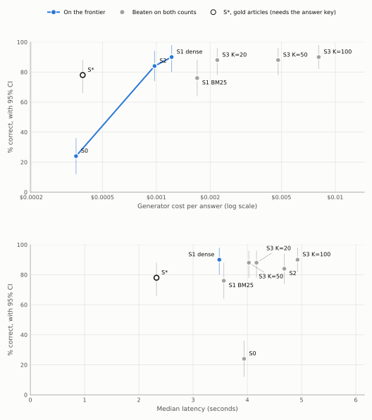

# Answer quality on dev_real

Generated by `srag report-answers`.

- Generator: claude-haiku-5-5, effort medium. Judge: claude-sonnet-5-5, rubric judge-v1, effort high, validated in D-031.
- % correct counts only answers graded correct; a decline is incorrect (D-025).
- 95% intervals come from resampling the questions 10,000 times. Comparisons are paired on the same questions: the difference has a paired-bootstrap interval, and McNemar's exact test uses only the questions where the two strategies differ. Holm's adjustment runs separately over each table of comparisons (D-032, D-046).
- Cost is what the generator was paid per answer, prompt caching included; judging isn't counted. Latency is over the answers paid for in the run (D-046).
- These are dev results, used for tuning. Claims come from the test set at a milestone (D-004).

## Strategies

| Strategy | Questions | % correct [95% CI] | Declined | Input tokens | Output tokens | Cost per answer | Latency p50 | Latency p95 |
|---|---:|---:|---:|---:|---:|---:|---:|---:|
| S0, closed book | 50 | 24.0% [12.0, 36.0] | 2 | 139 | 686 | $0.00036 | 3.9 s | 5.8 s |
| S1, BM25 top 10 | 50 | 76.0% [64.0, 88.0] | 2 | 13,572 | 670 | $0.00169 | 3.6 s | 6.5 s |
| S1, dense search top 10 | 50 | 90.0% [80.0, 98.0] | 0 | 8,758 | 685 | $0.00122 | 3.5 s | 6.0 s |
| S2, agentic search | 50 | 84.0% [74.0, 94.0] | 1 | 8,972 | 651 | $0.00098 | 4.7 s | 7.0 s |
| S3, long context, dense search up to 20 | 50 | 88.0% [78.0, 96.0] | 1 | 18,258 | 732 | $0.00219 | 4.2 s | 7.0 s |
| S3, long context, dense search up to 50 | 50 | 88.0% [78.0, 96.0] | 1 | 43,996 | 787 | $0.00479 | 4.0 s | 8.0 s |
| S3, long context, dense search up to 100 | 50 | 90.0% [82.0, 98.0] | 1 | 76,830 | 798 | $0.00808 | 4.9 s | 7.8 s |
| S*, gold articles | 50 | 78.0% [66.0, 88.0] | 3 | 1,598 | 457 | $0.00039 | 2.3 s | 4.7 s |

## The cost frontier

A strategy is on the frontier when no other strategy is both as cheap and as accurate (D-046). S\* stays off it, because it needs the answer key. A cost per extra correct answer is given only when the step's gain has an interval entirely above zero.

On cost per answer, the frontier is S0 → S2 → S1 dense.

| Step | Extra cost per answer | Extra % correct [95% CI] | Cost per extra correct answer |
|---|---:|---:|---:|
| S0 → S2 | +$0.00062 | +60.0 [+44.0, +74.0] | $0.0010 |
| S2 → S1 dense | +$0.00024 | +6.0 [-2.0, +16.0] | not shown to add correct answers |

On median latency, the frontier is S1 dense.

## Against the default

Each strategy against S1, dense search top 10, the default (D-042). One replaces the default only if its interval lies entirely above zero and its Holm p, over this table, is below 0.05 (D-046).

| Comparison | Questions | Difference, points [95% CI] | Only the first right | Only the second right | McNemar p | Holm p | Replaces the default |
|---|---:|---:|---:|---:|---:|---:|---:|
| S1, BM25 top 10 vs S1, dense search top 10 | 50 | -14.0 [-26.0, -2.0] | 2 | 9 | 0.065 | 0.327 | no |
| S2, agentic search vs S1, dense search top 10 | 50 | -6.0 [-16.0, +2.0] | 1 | 4 | 0.375 | 1.000 | no |
| S3, long context, dense search up to 20 vs S1, dense search top 10 | 50 | -2.0 [-6.0, +0.0] | 0 | 1 | 1.000 | 1.000 | no |
| S3, long context, dense search up to 50 vs S1, dense search top 10 | 50 | -2.0 [-8.0, +4.0] | 1 | 2 | 1.000 | 1.000 | no |
| S3, long context, dense search up to 100 vs S1, dense search top 10 | 50 | +0.0 [-6.0, +6.0] | 1 | 1 | 1.000 | 1.000 | no |

## What retrieval adds

These describe and decide nothing (D-046).

| Comparison | Questions | Difference, points [95% CI] | Only the first right | Only the second right | McNemar p | Holm p |
|---|---:|---:|---:|---:|---:|---:|
| S1, dense search top 10 vs S0, closed book | 50 | +66.0 [+52.0, +80.0] | 34 | 1 | <0.001 | <0.001 |
| S*, gold articles vs S1, dense search top 10 | 50 | -12.0 [-22.0, -4.0] | 0 | 6 | 0.031 | 0.031 |
| S*, gold articles vs S0, closed book | 50 | +54.0 [+40.0, +68.0] | 28 | 1 | <0.001 | <0.001 |

## By question type

Directional only, with no verdicts (D-046): the groups are small. The number of questions is in brackets.

| % correct | Single-article (41) | Multi-article (9) | Expert-written (25) | Simulated (25) |
|---|---:|---:|---:|---:|
| S0, closed book | 26.8% | 11.1% | 16.0% | 32.0% |
| S1, BM25 top 10 | 78.0% | 66.7% | 76.0% | 76.0% |
| S1, dense search top 10 | 87.8% | 100.0% | 92.0% | 88.0% |
| S2, agentic search | 82.9% | 88.9% | 84.0% | 84.0% |
| S3, long context, dense search up to 20 | 87.8% | 88.9% | 88.0% | 88.0% |
| S3, long context, dense search up to 50 | 87.8% | 88.9% | 84.0% | 92.0% |
| S3, long context, dense search up to 100 | 87.8% | 100.0% | 92.0% | 88.0% |
| S*, gold articles | 75.6% | 88.9% | 84.0% | 72.0% |

| Cost per answer | Single-article (41) | Multi-article (9) | Expert-written (25) | Simulated (25) |
|---|---:|---:|---:|---:|
| S0, closed book | $0.00034 | $0.00043 | $0.00038 | $0.00034 |
| S1, BM25 top 10 | $0.00170 | $0.00165 | $0.00180 | $0.00158 |
| S1, dense search top 10 | $0.00120 | $0.00131 | $0.00132 | $0.00112 |
| S2, agentic search | $0.00095 | $0.00111 | $0.00102 | $0.00094 |
| S3, long context, dense search up to 20 | $0.00213 | $0.00249 | $0.00229 | $0.00210 |
| S3, long context, dense search up to 50 | $0.00470 | $0.00523 | $0.00507 | $0.00452 |
| S3, long context, dense search up to 100 | $0.00813 | $0.00788 | $0.00816 | $0.00801 |
| S*, gold articles | $0.00035 | $0.00055 | $0.00042 | $0.00036 |

The cost frontier within each type:

- Single-article: S0 → S2 → S1 dense.
- Multi-article: S0 → S2 → S1 dense.
- Expert-written: S0 → S2 → S1 dense.
- Simulated: S0 → S2 → S1 dense → S3 K=50.

## S2's loop

- Tool steps per question: 43 took 2, 6 took 3, 1 took 4.
- Questions a limit ended: none.
- Per question: 1.7 searches and 2.0 reads. The largest prompt averaged 4,889 tokens.
- Tool calls that came back as errors: 0.
- Prompt caching: 4,077 of 8,972 input tokens per question were read from the cache. The run cost $0.0489, and would have cost $0.0611 without caching.

## S3's token cap

Articles go in best first, and the list stops before the estimated prompt passes 90,000 tokens, 10% under the 100,000-token price line (D-044). The estimate error is (real − estimated) / real; above zero means the estimate was low.

| Strategy | Cap cut the list | Articles sent, min / median / max | Largest prompt | Over 100K | Estimate error, min / median / max |
|---|---:|---:|---:|---:|---:|
| S3, long context, dense search up to 20 | 0 of 50 | 20 / 20 / 20 | 41,527 | 0 | -7.1% / -1.0% / +4.6% |
| S3, long context, dense search up to 50 | 1 of 50 | 45 / 50 / 50 | 85,282 | 0 | -5.0% / -0.8% / +3.7% |
| S3, long context, dense search up to 100 | 20 of 50 | 45 / 100 / 100 | 92,201 | 0 | -4.8% / -0.4% / +3.8% |

Runs: judge `20261102-232343_judge-high_20261102-173621_s0-medium_dev_real`, `20261102-232755_judge-high_20261102-173943_s_star-medium_dev_real`, `20261103-004215_judge-high_20261103-003456_s1-k10-medium_dev_real`, `20261108-122502_judge-high_20261108-121330_s1-dense-k10-medium_dev_real`, `20261113-003350_judge-high_20261113-002731_s2-medium_dev_real`, `20261113-141009_judge-high_20261113-135507_s3-k20-medium_dev_real`, `20261113-141316_judge-high_20261113-135901_s3-k50-medium_dev_real`, `20261113-141522_judge-high_20261113-140307_s3-k100-medium_dev_real`; answers `20261102-173621_s0-medium_dev_real`, `20261103-003456_s1-k10-medium_dev_real`, `20261108-121330_s1-dense-k10-medium_dev_real`, `20261113-002731_s2-medium_dev_real`, `20261113-135507_s3-k20-medium_dev_real`, `20261113-135901_s3-k50-medium_dev_real`, `20261113-140307_s3-k100-medium_dev_real`, `20261102-173943_s_star-medium_dev_real`.
