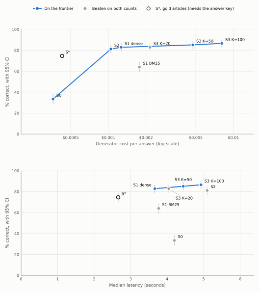

# Answer quality on test

Generated by `srag report-answers`.

- Generator: claude-haiku-5-5, effort medium. Judge: claude-sonnet-5-5, rubric judge-v1, effort high, validated in D-031.
- % correct counts only answers graded correct; a decline is incorrect (D-025).
- 95% intervals come from resampling the questions 10,000 times. Comparisons are paired on the same questions: the difference has a paired-bootstrap interval, and McNemar's exact test uses only the questions where the two strategies differ. Holm's adjustment runs separately over each table of comparisons (D-032, D-046).
- Cost is what the generator was paid per answer, prompt caching included; judging isn't counted. Latency is over the answers paid for in the run (D-046).
- Test set, milestone M1, M2, from commit 9d1b5fa, eadbd6a: run once with the settings tuned on dev (D-033). Nothing was changed after seeing these results (D-034).

## Strategies

| Strategy | Questions | % correct [95% CI] | Declined | Input tokens | Output tokens | Cost per answer | Latency p50 | Latency p95 |
|---|---:|---:|---:|---:|---:|---:|---:|---:|
| S0, closed book | 350 | 33.4% [28.6, 38.3] | 33 | 138 | 695 | $0.00036 | 4.2 s | 7.1 s |
| S1, BM25 top 10 | 350 | 64.0% [59.1, 68.9] | 37 | 14,201 | 703 | $0.00177 | 3.8 s | 6.7 s |
| S1, dense search top 10 | 350 | 82.9% [78.9, 86.6] | 11 | 9,076 | 719 | $0.00127 | 3.7 s | 6.3 s |
| S2, agentic search | 350 | 81.1% [76.9, 85.1] | 11 | 9,711 | 724 | $0.00105 | 5.1 s | 8.2 s |
| S3, long context, dense search up to 20 | 350 | 82.9% [78.9, 86.6] | 15 | 17,694 | 765 | $0.00215 | 4.0 s | 6.8 s |
| S3, long context, dense search up to 50 | 350 | 85.1% [81.4, 88.9] | 15 | 43,363 | 810 | $0.00474 | 4.4 s | 7.5 s |
| S3, long context, dense search up to 100 | 350 | 86.6% [82.9, 90.0] | 13 | 76,565 | 826 | $0.00807 | 4.9 s | 7.9 s |
| S*, gold articles | 350 | 74.6% [69.7, 78.9] | 34 | 1,785 | 497 | $0.00043 | 2.7 s | 5.6 s |

## The cost frontier

A strategy is on the frontier when no other strategy is both as cheap and as accurate (D-046). S\* stays off it, because it needs the answer key. A cost per extra correct answer is given only when the step's gain has an interval entirely above zero.

On cost per answer, the frontier is S0 → S2 → S1 dense → S3 K=50 → S3 K=100.

| Step | Extra cost per answer | Extra % correct [95% CI] | Cost per extra correct answer |
|---|---:|---:|---:|
| S0 → S2 | +$0.00069 | +47.7 [+41.4, +53.7] | $0.0014 |
| S2 → S1 dense | +$0.00022 | +1.7 [-2.0, +5.7] | not shown to add correct answers |
| S1 dense → S3 K=50 | +$0.00347 | +2.3 [-0.9, +5.7] | not shown to add correct answers |
| S3 K=50 → S3 K=100 | +$0.00333 | +1.4 [-1.7, +4.6] | not shown to add correct answers |

On median latency, the frontier is S1 dense → S3 K=50 → S3 K=100.

| Step | Extra median latency | Extra % correct [95% CI] |
|---|---:|---:|
| S1 dense → S3 K=50 | +0.8 s | +2.3 [-0.9, +5.7] |
| S3 K=50 → S3 K=100 | +0.5 s | +1.4 [-1.7, +4.6] |

## Against the default

Each strategy against S1, dense search top 10, the default (D-042). One replaces the default only if its interval lies entirely above zero and its Holm p, over this table, is below 0.05 (D-046).

| Comparison | Questions | Difference, points [95% CI] | Only the first right | Only the second right | McNemar p | Holm p | Replaces the default |
|---|---:|---:|---:|---:|---:|---:|---:|
| S1, BM25 top 10 vs S1, dense search top 10 | 350 | -18.9 [-23.7, -14.0] | 14 | 80 | <0.001 | <0.001 | no |
| S2, agentic search vs S1, dense search top 10 | 350 | -1.7 [-5.7, +2.0] | 21 | 27 | 0.471 | 0.942 | no |
| S3, long context, dense search up to 20 vs S1, dense search top 10 | 350 | +0.0 [-3.7, +3.7] | 21 | 21 | 1.000 | 1.000 | no |
| S3, long context, dense search up to 50 vs S1, dense search top 10 | 350 | +2.3 [-0.9, +5.7] | 22 | 14 | 0.243 | 0.729 | no |
| S3, long context, dense search up to 100 vs S1, dense search top 10 | 350 | +3.7 [+0.6, +7.1] | 25 | 12 | 0.047 | 0.188 | no |

## What retrieval adds

These describe and decide nothing (D-046).

| Comparison | Questions | Difference, points [95% CI] | Only the first right | Only the second right | McNemar p | Holm p |
|---|---:|---:|---:|---:|---:|---:|
| S1, dense search top 10 vs S0, closed book | 350 | +49.4 [+43.4, +55.4] | 187 | 14 | <0.001 | <0.001 |
| S*, gold articles vs S1, dense search top 10 | 350 | -8.3 [-12.9, -3.7] | 21 | 50 | <0.001 | <0.001 |
| S*, gold articles vs S0, closed book | 350 | +41.1 [+34.9, +47.4] | 167 | 23 | <0.001 | <0.001 |

## By question type

Directional only, with no verdicts (D-046): the groups are small. The number of questions is in brackets.

| % correct | Single-article (280) | Multi-article (70) | Expert-written (175) | Simulated (175) |
|---|---:|---:|---:|---:|
| S0, closed book | 35.0% | 27.1% | 31.4% | 35.4% |
| S1, BM25 top 10 | 63.6% | 65.7% | 70.9% | 57.1% |
| S1, dense search top 10 | 83.9% | 78.6% | 88.0% | 77.7% |
| S2, agentic search | 82.1% | 77.1% | 89.1% | 73.1% |
| S3, long context, dense search up to 20 | 81.8% | 87.1% | 89.7% | 76.0% |
| S3, long context, dense search up to 50 | 85.0% | 85.7% | 90.9% | 79.4% |
| S3, long context, dense search up to 100 | 87.1% | 84.3% | 93.1% | 80.0% |
| S*, gold articles | 73.2% | 80.0% | 81.7% | 67.4% |

| Cost per answer | Single-article (280) | Multi-article (70) | Expert-written (175) | Simulated (175) |
|---|---:|---:|---:|---:|
| S0, closed book | $0.00035 | $0.00039 | $0.00038 | $0.00034 |
| S1, BM25 top 10 | $0.00174 | $0.00190 | $0.00185 | $0.00169 |
| S1, dense search top 10 | $0.00124 | $0.00139 | $0.00137 | $0.00116 |
| S2, agentic search | $0.00103 | $0.00113 | $0.00108 | $0.00101 |
| S3, long context, dense search up to 20 | $0.00211 | $0.00233 | $0.00229 | $0.00201 |
| S3, long context, dense search up to 50 | $0.00464 | $0.00514 | $0.00504 | $0.00444 |
| S3, long context, dense search up to 100 | $0.00796 | $0.00852 | $0.00839 | $0.00775 |
| S*, gold articles | $0.00038 | $0.00063 | $0.00048 | $0.00038 |

The cost frontier within each type:

- Single-article: S0 → S2 → S1 dense → S3 K=50 → S3 K=100.
- Multi-article: S0 → S2 → S1 dense → S3 K=20.
- Expert-written: S0 → S2 → S3 K=20 → S3 K=50 → S3 K=100.
- Simulated: S0 → S2 → S1 dense → S3 K=50 → S3 K=100.

## S2's loop

- Tool steps per question: 291 took 2, 43 took 3, 15 took 4, 1 took 5.
- Questions a limit ended: none.
- Per question: 2.1 searches and 2.0 reads. The largest prompt averaged 5,112 tokens.
- Tool calls that came back as errors: 0.
- Prompt caching: 4,593 of 9,711 input tokens per question were read from the cache. The run cost $0.3666, and would have cost $0.4665 without caching.

## S3's token cap

Articles go in best first, and the list stops before the estimated prompt passes 90,000 tokens, 10% under the 100,000-token price line (D-044). The estimate error is (real − estimated) / real; above zero means the estimate was low.

| Strategy | Cap cut the list | Articles sent, min / median / max | Largest prompt | Over 100K | Estimate error, min / median / max |
|---|---:|---:|---:|---:|---:|
| S3, long context, dense search up to 20 | 0 of 350 | 20 / 20 / 20 | 46,630 | 0 | -7.4% / -0.7% / +9.0% |
| S3, long context, dense search up to 50 | 6 of 350 | 40 / 50 / 50 | 86,714 | 0 | -6.4% / -0.8% / +7.0% |
| S3, long context, dense search up to 100 | 141 of 350 | 40 / 100 / 100 | 94,514 | 0 | -5.8% / -0.6% / +5.6% |

Runs: judge `20261103-104813_judge-high_20261103-094139_s0-medium_test`, `20261103-113402_judge-high_20261103-104818_s1-k10-medium_test`, `20261103-115433_judge-high_20261103-113403_s_star-medium_test`, `20261113-231125_judge-high_20261113-224600_s1-dense-k10-medium_test`, `20261113-234409_judge-high_20261113-230937_s2-medium_test`, `20261114-000944_judge-high_20261113-234118_s3-k20-medium_test`, `20261114-003752_judge-high_20261114-000653_s3-k50-medium_test`, `20261114-010805_judge-high_20261114-003505_s3-k100-medium_test`; answers `20261103-094139_s0-medium_test`, `20261103-104818_s1-k10-medium_test`, `20261113-224600_s1-dense-k10-medium_test`, `20261113-230937_s2-medium_test`, `20261113-234118_s3-k20-medium_test`, `20261114-000653_s3-k50-medium_test`, `20261114-003505_s3-k100-medium_test`, `20261103-113403_s_star-medium_test`.
