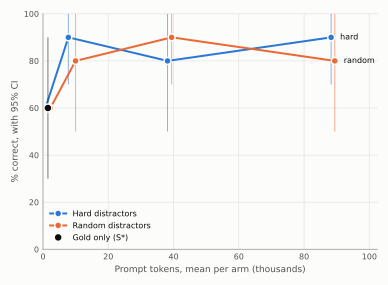

# Context rot on dev_real

Generated by `srag report-rot`.

- 10 questions. Each question's gold articles were buried among distractors up to an estimated prompt size: hard distractors are dense search's top-ranked non-gold articles, random ones are drawn from the rest. Each gold article sits at one random depth, the same in every arm. The gold-only arm is S\* (D-045).
- Judge: claude-sonnet-5-5, rubric judge-v1, effort high. % correct counts only answers graded correct; a decline is incorrect (D-025).
- Comparisons are paired on the same questions, with a paired-bootstrap interval and McNemar's exact test. Holm's adjustment runs separately over each table.

## % correct by context size

| Arm | Questions | % correct [95% CI] | Prompt tokens | Distractors | Cited a distractor | Over 100K | Cost per answer |
|---|---:|---:|---:|---:|---:|---:|---:|
| gold only | 10 | 60.0% [30.0, 90.0] | 1,510 | 0.0 | 0 | 0 | $0.00043 |
| hard, 10K | 10 | 90.0% [70.0, 100.0] | 8,533 | 10.8 | 7 | 0 | $0.00061 |
| random, 10K | 10 | 80.0% [50.0, 100.0] | 9,213 | 13.7 | 0 | 0 | $0.00060 |
| hard, 40K | 10 | 80.0% [50.0, 100.0] | 38,921 | 51.1 | 10 | 0 | $0.00214 |
| random, 40K | 10 | 90.0% [70.0, 100.0] | 38,646 | 56.3 | 0 | 0 | $0.00206 |
| hard, 90K | 10 | 90.0% [70.0, 100.0] | 89,052 | 117.6 | 9 | 0 | $0.00468 |
| random, 90K | 10 | 80.0% [50.0, 100.0] | 88,642 | 124.5 | 1 | 0 | $0.00458 |

## Largest against smallest, same type

The main measure of rot: the same gold at the same depth, with more distractors.

| Comparison | Questions | Difference, points [95% CI] | Only the first right | Only the second right | McNemar p | Holm p |
|---|---:|---:|---:|---:|---:|---:|
| hard, 90K vs 10K | 10 | +0.0 [+0.0, +0.0] | 0 | 0 | 1.000 | 1.000 |
| random, 90K vs 10K | 10 | +0.0 [+0.0, +0.0] | 0 | 0 | 1.000 | 1.000 |

## Against the gold only

All of these share one gold-only sample, so their differences move together.

| Comparison | Questions | Difference, points [95% CI] | Only the first right | Only the second right | McNemar p | Holm p |
|---|---:|---:|---:|---:|---:|---:|
| hard, 10K vs gold only | 10 | +30.0 [+0.0, +60.0] | 3 | 0 | 0.250 | 1.000 |
| random, 10K vs gold only | 10 | +20.0 [+0.0, +50.0] | 2 | 0 | 0.500 | 1.000 |
| hard, 40K vs gold only | 10 | +20.0 [+0.0, +50.0] | 2 | 0 | 0.500 | 1.000 |
| random, 40K vs gold only | 10 | +30.0 [+0.0, +60.0] | 3 | 0 | 0.250 | 1.000 |
| hard, 90K vs gold only | 10 | +30.0 [+0.0, +60.0] | 3 | 0 | 0.250 | 1.000 |
| random, 90K vs gold only | 10 | +20.0 [+0.0, +50.0] | 2 | 0 | 0.500 | 1.000 |

## Hard against random, same size

| Comparison | Questions | Difference, points [95% CI] | Only the first right | Only the second right | McNemar p | Holm p |
|---|---:|---:|---:|---:|---:|---:|
| hard vs random, 10K | 10 | +10.0 [+0.0, +30.0] | 1 | 0 | 1.000 | 1.000 |
| hard vs random, 40K | 10 | -10.0 [-30.0, +0.0] | 0 | 1 | 1.000 | 1.000 |
| hard vs random, 90K | 10 | +10.0 [+0.0, +30.0] | 1 | 0 | 1.000 | 1.000 |

## Single- and multi-article questions

Directional: % correct, with the number of questions in brackets.

| Arm | Single-article | Multi-article |
|---|---:|---:|
| gold only | 55.6% (9) | 100.0% (1) |
| hard, 10K | 88.9% (9) | 100.0% (1) |
| random, 10K | 77.8% (9) | 100.0% (1) |
| hard, 40K | 77.8% (9) | 100.0% (1) |
| random, 40K | 88.9% (9) | 100.0% (1) |
| hard, 90K | 88.9% (9) | 100.0% (1) |
| random, 90K | 77.8% (9) | 100.0% (1) |

## Where the gold article sat, at the largest size

Directional, single-article questions only: % correct by the gold article's depth, with the number of questions in brackets.

| Arm | First third | Middle third | Last third |
|---|---:|---:|---:|
| hard, 90K | 100.0% (2) | 100.0% (4) | 66.7% (3) |
| random, 90K | 50.0% (2) | 100.0% (4) | 66.7% (3) |

Runs: judge `20261102-232755_judge-high_20261102-173943_s_star-medium_dev_real`, `20261113-154014_judge-high_20261113-152339_rot-hard-10k-medium_dev_real`, `20261113-154922_judge-high_20261113-152704_rot-hard-40k-medium_dev_real`, `20261113-155228_judge-high_20261113-153028_rot-hard-90k-medium_dev_real`, `20261113-155434_judge-high_20261113-153335_rot-random-10k-medium_dev_real`, `20261113-155741_judge-high_20261113-153542_rot-random-40k-medium_dev_real`, `20261113-155946_judge-high_20261113-153748_rot-random-90k-medium_dev_real`; answers `20261102-173943_s_star-medium_dev_real`, `20261113-152339_rot-hard-10k-medium_dev_real`, `20261113-153335_rot-random-10k-medium_dev_real`, `20261113-152704_rot-hard-40k-medium_dev_real`, `20261113-153542_rot-random-40k-medium_dev_real`, `20261113-153028_rot-hard-90k-medium_dev_real`, `20261113-153748_rot-random-90k-medium_dev_real`.
