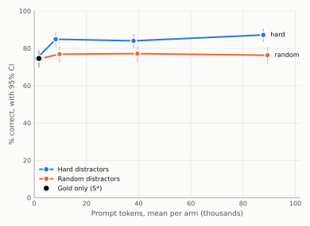

# Context rot on test

Generated by `srag report-rot`.

- 350 questions. Each question's gold articles were buried among distractors up to an estimated prompt size: hard distractors are dense search's top-ranked non-gold articles, random ones are drawn from the rest. Each gold article sits at one random depth, the same in every arm. The gold-only arm is S\* (D-045).
- Judge: claude-sonnet-5-5, rubric judge-v1, effort high. % correct counts only answers graded correct; a decline is incorrect (D-025).
- Comparisons are paired on the same questions, with a paired-bootstrap interval and McNemar's exact test. Holm's adjustment runs separately over each table.

## % correct by context size

| Arm | Questions | % correct [95% CI] | Prompt tokens | Distractors | Cited a distractor | Over 100K | Cost per answer |
|---|---:|---:|---:|---:|---:|---:|---:|
| gold only | 350 | 74.6% [69.7, 78.9] | 1,785 | 0.0 | 0 | 0 | $0.00043 |
| hard, 10K | 350 | 84.9% [81.1, 88.6] | 8,988 | 10.8 | 256 | 0 | $0.00063 |
| random, 10K | 350 | 76.9% [72.3, 81.1] | 8,930 | 11.6 | 6 | 0 | $0.00058 |
| hard, 40K | 350 | 84.0% [80.0, 87.7] | 38,794 | 48.5 | 267 | 0 | $0.00214 |
| random, 40K | 350 | 77.1% [72.6, 81.4] | 38,761 | 52.6 | 20 | 0 | $0.00208 |
| hard, 90K | 350 | 87.1% [83.4, 90.6] | 88,493 | 109.3 | 273 | 0 | $0.00463 |
| random, 90K | 350 | 76.3% [71.7, 80.6] | 88,587 | 121.2 | 40 | 0 | $0.00458 |

## Largest against smallest, same type

The main measure of rot: the same gold at the same depth, with more distractors.

| Comparison | Questions | Difference, points [95% CI] | Only the first right | Only the second right | McNemar p | Holm p |
|---|---:|---:|---:|---:|---:|---:|
| hard, 90K vs 10K | 350 | +2.3 [-0.9, +5.7] | 22 | 14 | 0.243 | 0.486 |
| random, 90K vs 10K | 350 | -0.6 [-4.0, +2.6] | 16 | 18 | 0.864 | 0.864 |

## Against the gold only

All of these share one gold-only sample, so their differences move together.

| Comparison | Questions | Difference, points [95% CI] | Only the first right | Only the second right | McNemar p | Holm p |
|---|---:|---:|---:|---:|---:|---:|
| hard, 10K vs gold only | 350 | +10.3 [+5.7, +14.9] | 53 | 17 | <0.001 | <0.001 |
| random, 10K vs gold only | 350 | +2.3 [-0.6, +5.1] | 18 | 10 | 0.185 | 0.370 |
| hard, 40K vs gold only | 350 | +9.4 [+4.9, +14.0] | 52 | 19 | <0.001 | <0.001 |
| random, 40K vs gold only | 350 | +2.6 [+0.0, +5.4] | 17 | 8 | 0.108 | 0.323 |
| hard, 90K vs gold only | 350 | +12.6 [+8.0, +17.4] | 61 | 17 | <0.001 | <0.001 |
| random, 90K vs gold only | 350 | +1.7 [-1.4, +4.9] | 19 | 13 | 0.377 | 0.377 |

## Hard against random, same size

| Comparison | Questions | Difference, points [95% CI] | Only the first right | Only the second right | McNemar p | Holm p |
|---|---:|---:|---:|---:|---:|---:|
| hard vs random, 10K | 350 | +8.0 [+3.7, +12.6] | 47 | 19 | <0.001 | 0.002 |
| hard vs random, 40K | 350 | +6.9 [+2.6, +11.1] | 43 | 19 | 0.003 | 0.003 |
| hard vs random, 90K | 350 | +10.9 [+6.3, +15.7] | 58 | 20 | <0.001 | <0.001 |

## Single- and multi-article questions

Directional: % correct, with the number of questions in brackets.

| Arm | Single-article | Multi-article |
|---|---:|---:|
| gold only | 73.2% (280) | 80.0% (70) |
| hard, 10K | 84.3% (280) | 87.1% (70) |
| random, 10K | 75.4% (280) | 82.9% (70) |
| hard, 40K | 84.3% (280) | 82.9% (70) |
| random, 40K | 76.1% (280) | 81.4% (70) |
| hard, 90K | 86.1% (280) | 91.4% (70) |
| random, 90K | 76.1% (280) | 77.1% (70) |

## Where the gold article sat, at the largest size

Directional, single-article questions only: % correct by the gold article's depth, with the number of questions in brackets.

| Arm | First third | Middle third | Last third |
|---|---:|---:|---:|
| hard, 90K | 80.2% (81) | 91.5% (118) | 84.0% (81) |
| random, 90K | 74.1% (81) | 77.1% (118) | 76.5% (81) |

Runs: judge `20261103-115433_judge-high_20261103-113403_s_star-medium_test`, `20261114-010933_judge-high_20261114-010713_rot-random-10k-medium_test`, `20261114-011040_judge-high_20261114-010720_rot-random-40k-medium_test`, `20261114-011053_judge-high_20261114-010729_rot-random-90k-medium_test`, `20261114-011133_judge-high_20261114-010906_rot-hard-90k-medium_test`, `20261114-011224_judge-high_20261114-010858_rot-hard-40k-medium_test`, `20261114-011315_judge-high_20261114-010851_rot-hard-10k-medium_test`; answers `20261103-113403_s_star-medium_test`, `20261114-010851_rot-hard-10k-medium_test`, `20261114-010713_rot-random-10k-medium_test`, `20261114-010858_rot-hard-40k-medium_test`, `20261114-010720_rot-random-40k-medium_test`, `20261114-010906_rot-hard-90k-medium_test`, `20261114-010729_rot-random-90k-medium_test`.
