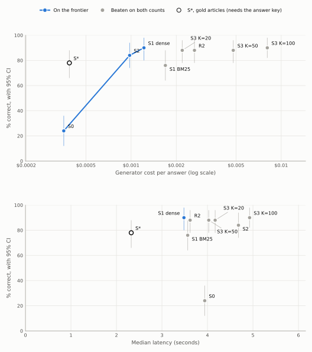

# The router on dev_real

Generated by `srag report-router`.

- R2 (D-048): if dense search's top score is below 0.5615, S3 at K=100 answers straight away; otherwise S1 answers from the top 10, and if it declines, S3 at K=100 answers again. The threshold is a 20% budget over the real dev questions' top scores, not a tuned value (D-047).
- Judge: claude-sonnet-5-5, rubric judge-v1, effort high. % correct counts only answers graded correct; a decline is incorrect (D-025).
- R2's calls repeat S1's and S3's, so the call cache answered them. Its cost adds up the calls it made, and its latency adds up their original real-time latencies, which the cache keeps.
- R2's run: `20261114-195916_r2-medium_dev_real`, from commit dd712f0. These are dev results: nothing on dev decides anything (D-047).

## Where the questions went

| Route | Questions | Share |
|---|---:|---:|
| S1's answer stands | 40 | 80.0% |
| Weak top score: straight to S3 at K=100 | 10 | 20.0% |
| S1 declined: S3 at K=100 answers again | 0 | 0.0% |
| Sent to S3 in all | 10 | 20.0% |

The median top score was 0.6381.

## The verdicts

Each comparison needs a paired 95% interval entirely above zero and a Holm p below 0.05 over these two (D-048). The first p is a one-sided permutation test over 10,000 random sets of the same size; the second is McNemar's exact test.

| Comparison | Questions | Difference, points [95% CI] | Detail | p | Holm p | Passes |
|---|---:|---:|---|---:|---:|---:|
| R2 against random escalation at the same rate | 50 | -2.0 [-5.6, +0.0] | R2's 10 gained -1; a random 10 gains +0.0 on average | 1.000 | 1.000 | no |
| R2 against S1 | 50 | -2.0 [-6.0, +0.0] | only R2 right 0, only S1 right 1 | 1.000 | 1.000 | no |

R2 becomes the default: **no**. S1 on dense search stays the default (D-048).

## R2 beside the strategies it chooses between

| Strategy | % correct [95% CI] | Cost per answer | Latency p50 | Latency p95 |
|---|---:|---:|---:|---:|
| S1, dense search top 10 | 90.0% [80.0, 98.0] | $0.00122 | 3.5 s | 6.0 s |
| R2, router: S1 top 10, or S3 up to 100 | 88.0% [78.0, 96.0] | $0.00264 | 3.6 s | 6.0 s |
| Random escalation at R2's rate, expected | 90.0% | $0.00259 | | |
| S3, long context, dense search up to 100 | 90.0% [82.0, 98.0] | $0.00808 | 4.9 s | 7.8 s |

S3 at K=100 isn't ahead of S1 here, so there's no gain to keep. R2 costs 33% of what S3 does per answer.

## Each signal alone, and other budgets

Replays of the same rule on S1's and S3's runs, with thresholds fixed in D-048. These describe and decide nothing.

| Rule | Threshold | Sent to S3 | % correct | Against S1, points | Against random, points | Cost per answer |
|---|---:|---:|---:|---:|---:|---:|
| Both signals, 10% budget | 0.5313 | 5 | 90.0% | +0.0 | +0.0 | $0.00195 |
| Both signals, 20% budget (R2) | 0.5615 | 10 | 88.0% | -2.0 | -2.0 | $0.00264 |
| Both signals, 30% budget | 0.5889 | 15 | 88.0% | -2.0 | -2.0 | $0.00332 |
| Both signals, 50% budget | 0.6415 | 26 | 88.0% | -2.0 | -2.0 | $0.00488 |
| Weak top score only, 20% budget | 0.5615 | 10 | 88.0% | -2.0 | -2.0 | $0.00264 |
| S1's decline only | n/a | 0 | 90.0% | +0.0 | +0.0 | $0.00122 |

## The hindsight oracle

For each question, the cheapest strategy that got it right: the ceiling for any router choosing among them.

| Strategies it may choose | % correct | Cost per answer |
|---|---:|---:|
| S1 dense, S3 K=100 | 92.0% | $0.00133 |
| S1 dense, S2, S3 K=20, S3 K=50, S3 K=100 | 92.0% | $0.00096 |

## By question type

Directional only: the groups are small.

| Type | Questions | Sent to S3 | S1 | R2 | S3 K=100 |
|---|---:|---:|---:|---:|---:|
| Single-article | 41 | 8 | 87.8% | 85.4% | 87.8% |
| Multi-article | 9 | 2 | 100.0% | 100.0% | 100.0% |
| Expert-written | 25 | 1 | 92.0% | 92.0% | 92.0% |
| Simulated | 25 | 9 | 88.0% | 84.0% | 88.0% |

## The run against a replay

Replaying R2's rule on S1's and S3's runs gives the same route on 50 of 50 questions and the same grade on 50 of 50. A difference means a call missed the cache, or the runs differ.

## The cost frontier

A strategy is on the frontier when no other strategy is both as cheap and as accurate (D-046). S\* stays off it, because it needs the answer key. A cost per extra correct answer is given only when the step's gain has an interval entirely above zero.

On cost per answer, the frontier is S0 → S2 → S1 dense.

| Step | Extra cost per answer | Extra % correct [95% CI] | Cost per extra correct answer |
|---|---:|---:|---:|
| S0 → S2 | +$0.00062 | +60.0 [+44.0, +74.0] | $0.0010 |
| S2 → S1 dense | +$0.00024 | +6.0 [-2.0, +16.0] | not shown to add correct answers |

On median latency, the frontier is S1 dense.

Runs: judge `20261102-232343_judge-high_20261102-173621_s0-medium_dev_real`, `20261102-232755_judge-high_20261102-173943_s_star-medium_dev_real`, `20261103-004215_judge-high_20261103-003456_s1-k10-medium_dev_real`, `20261108-122502_judge-high_20261108-121330_s1-dense-k10-medium_dev_real`, `20261113-003350_judge-high_20261113-002731_s2-medium_dev_real`, `20261113-141009_judge-high_20261113-135507_s3-k20-medium_dev_real`, `20261113-141316_judge-high_20261113-135901_s3-k50-medium_dev_real`, `20261113-141522_judge-high_20261113-140307_s3-k100-medium_dev_real`, `20261114-195929_judge-high_20261114-195916_r2-medium_dev_real`.
