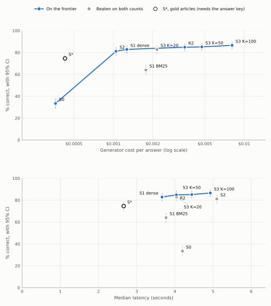

# The router on test

Generated by `srag report-router`.

- R2 (D-048): if dense search's top score is below 0.5615, S3 at K=100 answers straight away; otherwise S1 answers from the top 10, and if it declines, S3 at K=100 answers again. The threshold is a 20% budget over the real dev questions' top scores, not a tuned value (D-047).
- Judge: claude-sonnet-5-5, rubric judge-v1, effort high. % correct counts only answers graded correct; a decline is incorrect (D-025).
- R2's calls repeat S1's and S3's, so the call cache answered them. Its cost adds up the calls it made, and its latency adds up their original real-time latencies, which the cache keeps.
- R2's run: `20261114-200420_r2-medium_test`, from commit d544f94, milestone M3.

## Where the questions went

| Route | Questions | Share |
|---|---:|---:|
| S1's answer stands | 232 | 66.3% |
| Weak top score: straight to S3 at K=100 | 114 | 32.6% |
| S1 declined: S3 at K=100 answers again | 4 | 1.1% |
| Sent to S3 in all | 118 | 33.7% |

The median top score was 0.6072.

## The verdicts

Each comparison needs a paired 95% interval entirely above zero and a Holm p below 0.05 over these two (D-048). The first p is a one-sided permutation test over 10,000 random sets of the same size; the second is McNemar's exact test.

| Comparison | Questions | Difference, points [95% CI] | Detail | p | Holm p | Passes |
|---|---:|---:|---|---:|---:|---:|
| R2 against random escalation at the same rate | 350 | +0.7 [-0.9, +2.5] | R2's 118 gained +7; a random 118 gains +4.4 on average | 0.225 | 0.237 | no |
| R2 against S1 | 350 | +2.0 [+0.0, +4.3] | only R2 right 11, only S1 right 4 | 0.118 | 0.237 | no |

R2 becomes the default: **no**. S1 on dense search stays the default (D-048).

## R2 beside the strategies it chooses between

| Strategy | % correct [95% CI] | Cost per answer | Latency p50 | Latency p95 |
|---|---:|---:|---:|---:|
| S1, dense search top 10 | 82.9% [78.9, 86.6] | $0.00127 | 3.7 s | 6.3 s |
| R2, router: S1 top 10, or S3 up to 100 | 84.9% [81.1, 88.6] | $0.00351 | 4.0 s | 7.1 s |
| Random escalation at R2's rate, expected | 84.1% | $0.00356 | | |
| S3, long context, dense search up to 100 | 86.6% [82.9, 90.0] | $0.00807 | 4.9 s | 7.9 s |

R2 keeps 54% of S3 at K=100's gain over S1, at 44% of its cost per answer.

## Each signal alone, and other budgets

Replays of the same rule on S1's and S3's runs, with thresholds fixed in D-048. These describe and decide nothing.

| Rule | Threshold | Sent to S3 | % correct | Against S1, points | Against random, points | Cost per answer |
|---|---:|---:|---:|---:|---:|---:|
| Both signals, 10% budget | 0.5313 | 72 | 84.3% | +1.4 | +0.7 | $0.00262 |
| Both signals, 20% budget (R2) | 0.5615 | 118 | 84.9% | +2.0 | +0.7 | $0.00351 |
| Both signals, 30% budget | 0.5889 | 155 | 85.1% | +2.3 | +0.6 | $0.00422 |
| Both signals, 50% budget | 0.6415 | 245 | 86.3% | +3.4 | +0.8 | $0.00598 |
| Weak top score only, 20% budget | 0.5615 | 114 | 84.3% | +1.4 | +0.2 | $0.00343 |
| S1's decline only | n/a | 11 | 84.0% | +1.1 | +1.0 | $0.00151 |

## The hindsight oracle

For each question, the cheapest strategy that got it right: the ceiling for any router choosing among them.

| Strategies it may choose | % correct | Cost per answer |
|---|---:|---:|
| S1 dense, S3 K=100 | 90.0% | $0.00176 |
| S1 dense, S2, S3 K=20, S3 K=50, S3 K=100 | 93.7% | $0.00112 |

## By question type

Directional only: the groups are small.

| Type | Questions | Sent to S3 | S1 | R2 | S3 K=100 |
|---|---:|---:|---:|---:|---:|
| Single-article | 280 | 98 | 83.9% | 86.1% | 87.1% |
| Multi-article | 70 | 20 | 78.6% | 80.0% | 84.3% |
| Expert-written | 175 | 43 | 88.0% | 90.9% | 93.1% |
| Simulated | 175 | 75 | 77.7% | 78.9% | 80.0% |

## The run against a replay

Replaying R2's rule on S1's and S3's runs gives the same route on 350 of 350 questions and the same grade on 350 of 350. A difference means a call missed the cache, or the runs differ.

## The cost frontier

A strategy is on the frontier when no other strategy is both as cheap and as accurate (D-046). S\* stays off it, because it needs the answer key. A cost per extra correct answer is given only when the step's gain has an interval entirely above zero.

On cost per answer, the frontier is S0 → S2 → S1 dense → R2 → S3 K=50 → S3 K=100.

| Step | Extra cost per answer | Extra % correct [95% CI] | Cost per extra correct answer |
|---|---:|---:|---:|
| S0 → S2 | +$0.00069 | +47.7 [+41.4, +53.7] | $0.0014 |
| S2 → S1 dense | +$0.00022 | +1.7 [-2.0, +5.7] | not shown to add correct answers |
| S1 dense → R2 | +$0.00225 | +2.0 [+0.0, +4.3] | not shown to add correct answers |
| R2 → S3 K=50 | +$0.00123 | +0.3 [-2.9, +3.4] | not shown to add correct answers |
| S3 K=50 → S3 K=100 | +$0.00333 | +1.4 [-1.7, +4.6] | not shown to add correct answers |

On median latency, the frontier is S1 dense → R2 → S3 K=50 → S3 K=100.

| Step | Extra median latency | Extra % correct [95% CI] |
|---|---:|---:|
| S1 dense → R2 | +0.4 s | +2.0 [+0.0, +4.3] |
| R2 → S3 K=50 | +0.4 s | +0.3 [-2.9, +3.4] |
| S3 K=50 → S3 K=100 | +0.5 s | +1.4 [-1.7, +4.6] |

Runs: judge `20261103-104813_judge-high_20261103-094139_s0-medium_test`, `20261103-113402_judge-high_20261103-104818_s1-k10-medium_test`, `20261103-115433_judge-high_20261103-113403_s_star-medium_test`, `20261113-231125_judge-high_20261113-224600_s1-dense-k10-medium_test`, `20261113-234409_judge-high_20261113-230937_s2-medium_test`, `20261114-000944_judge-high_20261113-234118_s3-k20-medium_test`, `20261114-003752_judge-high_20261114-000653_s3-k50-medium_test`, `20261114-010805_judge-high_20261114-003505_s3-k100-medium_test`, `20261114-200500_judge-high_20261114-200420_r2-medium_test`.
